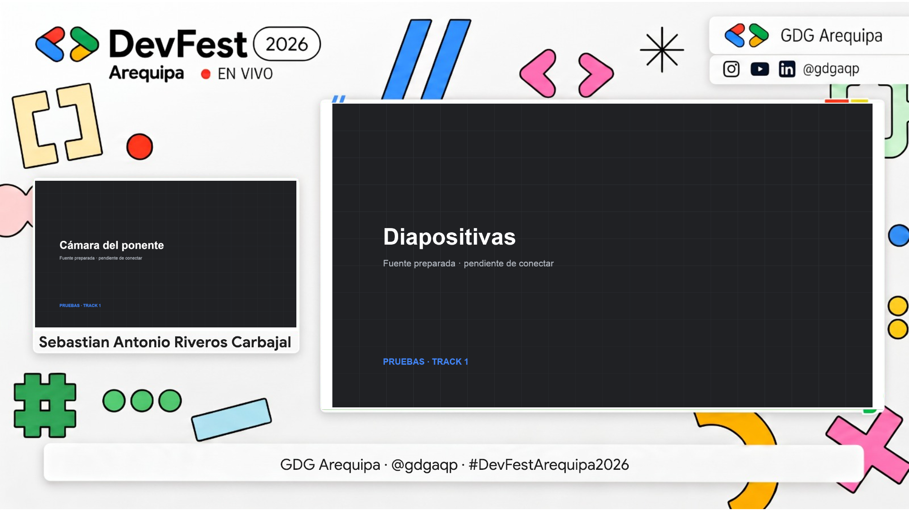

# DevFest Arequipa 2026 · OBS

Sistema completo de producción local para GDG Arequipa · **@gdgaqp**.

Dos Mac independientes: Track 1, Auditorio R Grandote; Track 2, Auditorio B. Cada Mac abre la misma página local y controla su propio OBS. Resolución 1920×1080 a 30 FPS; 13 escenas por track; 15 nombres de prueba; sin contadores regresivos.



## Contenido

Incluye código fuente del panel y servidor, HTML/CSS/JavaScript de emisión, colecciones importables de OBS, perfiles sin claves, gráficos transparentes, pantallas PNG, fuentes, cuatro MP4 oficiales, GIF de referencia, transición con alfa, datos de ponentes, ZIP original, guías PPTX suministradas y resultados de las pruebas. Incluye el ensayo en MP4 y su MKV original.

- [Guía de operación e instalación](08_Guias/OPERACION.md)
- [Resultados y límites de las pruebas](09_Pruebas/RESULTADOS.md)
- [Procedencia de los recursos oficiales](08_Guias/RECURSOS_OFICIALES.json)
- Guías originales completas en `10_Referencias/Guias`.

Los respaldos privados de OBS y sus claves se conservan fuera del repositorio. El estado de cada Mac y las futuras grabaciones se excluyen mediante `.gitignore`. Las fuentes, marcas y recursos de terceros conservan sus condiciones de uso; esta carpeta no les asigna una licencia libre nueva.

## Preparar GitHub

Repositorio de destino: **https://github.com/0mishino5/obs-devfest**. Los recursos grandes se almacenan mediante Git LFS junto al historial del código.

La guía DevFest tiene aproximadamente 105 MiB: GitHub rechaza archivos superiores a 100 MiB en Git normal. `.gitattributes` configura Git LFS para PPTX, videos, GIF, fuentes y ZIP.

**Instala Git LFS antes de ejecutar `git add`.** Puedes instalarlo desde https://git-lfs.com/ o, si tienes Homebrew, con `brew install git-lfs`. Después, dentro de esta carpeta:

```sh
git lfs install --local
git add .
git lfs ls-files
git commit -m "Preparar producción OBS DevFest Arequipa 2026"
```

Para una copia sin remoto, agrega la URL del repositorio del equipo antes del primer push. Si ya existe `origin`, conserva su configuración.

```sh
git remote add origin https://github.com/0mishino5/obs-devfest.git
git push -u origin main
```

Git LFS usa almacenamiento y transferencia de la cuenta de GitHub según su plan. No subas como un único archivo ZIP esta carpeta: sube su contenido con Git y Git LFS.

Referencias oficiales: [límites de archivos](https://docs.github.com/en/repositories/working-with-files/managing-large-files/about-large-files-on-github), [Git LFS](https://docs.github.com/en/repositories/working-with-files/managing-large-files/about-git-large-file-storage).

## Usar en cada Mac

Necesita OBS Studio y Node.js 22 o superior. Al clonar, instala Git LFS y ejecuta `git lfs pull` para obtener los archivos completos. Conserva la carpeta en una ubicación estable; se recomienda `/Users/Shared/devfest-arequipa-2026-obs`.

Con OBS cerrado, ejecuta `INSTALAR_MAC.command`. Este hace un respaldo local y añade colecciones nuevas; preserva los perfiles existentes. Si ya existe una colección del mismo nombre, se detiene sin reemplazarla. Para una importación manual, ejecuta `PREPARAR_IMPORTACION.command` y sigue la guía.

Selecciona la colección terminada en `_MARCA` y el perfil del track, habilita el servidor WebSocket autenticado de OBS y ejecuta `INICIAR_PANEL.command`. Abre http://127.0.0.1:8787 en cada Mac. Cada página solo controla el OBS local.

Las rutas de las colecciones se ajustan con `node 06_OBS/preparar.mjs` después de mover o clonar la carpeta. Ese comando no instala nada en OBS; prepara los JSON y perfiles del paquete.

```sh
node 09_Pruebas/verificar.mjs
```

Las cámaras, el audio físico y los destinos de emisión se configuran después en OBS. La prueba simultánea con ambos equipos sigue pendiente. El panel no inicia transmisiones.
